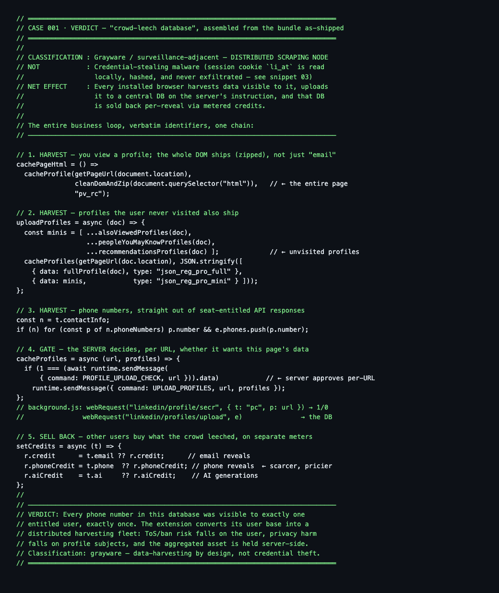

# Chrome Extension Analysis

Case-by-case static reverse engineering and threat-intelligence assessments of browser extensions. Each case is a self-contained study: enumerated permissions, audited data flows, network egress map, and acquisition mechanisms — with every claim anchored to verifiable evidence.

## Scope

- **Artifact type:** Chrome Web Store CRX3 (Manifest V2/V3)
- **Method:** static analysis only — no deobfuscation beyond reading minified webpack bundles; no vendor code republished beyond short annotated excerpts supporting specific findings
- **Framing:** neutral. Verdicts distinguish *credential theft*, *data harvesting*, *telemetry*, and *product function* — these are different things and get different answers

## Cases

| # | Case | Verdict (short) |
|---|---|---|
| 001 | [ContactOut Email Finder](cases/001-contactout-email-finder/README.md) (`jjdemeiffadmmjhkbbpglgnlgeafomjo`, v5.18.3) | Not credential malware — a **distributed scraping node**: server-directed profile harvesting, internal-API tapping, whole-DOM upload; session cookie (`li_at`) read locally, never exfiltrated |

*(new cases appended as `cases/NNN-slug/`)*

### Case 001 — the crowd-leech loop, in one snippet

[](cases/001-contactout-email-finder/evidence/snippets/00-verdict-crowd-leech.js)

*Verbatim chain from the shipped bundle: every installed browser harvests pages it views (whole DOM + unvisited bystanders), the server approves each URL per-upload (`1/0`), phones come out of seat-entitled API responses, and the aggregated DB is sold back via metered credits. Source: [`00-verdict-crowd-leech.js`](cases/001-contactout-email-finder/evidence/snippets/00-verdict-crowd-leech.js).*

## Case anatomy

```
cases/NNN-slug/
├── README.md          # executive summary + verdict table
├── docs/00..NN        # numbered findings (surface → permissions → credentials → pipeline → egress → mechanisms)
├── evidence/
│   ├── manifest.json  # verbatim factual surface
│   └── snippets/      # annotated fragments, file + byte-offset anchored
└── REPRODUCING.md     # target version, commands, method notes
```

Shared tooling lives in [`tools/`](tools/) — CRX3 fetcher/stripper and a context-window extractor for minified bundles.

## Why byte offsets

Minified bundles change constantly; string identifiers and structural patterns don't. Anchoring claims to `file @offset` + quoting the matching identifiers makes findings re-verifiable against any future version even after offsets drift.

## Legal notice

Analyses are performed on publicly downloadable artifacts for interoperability and security-research understanding. No affiliation with, or endorsement by, any extension publisher. All trademarks belong to their owners.
